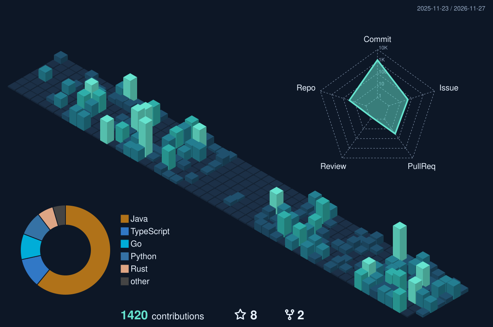

# pepelys

Hi, I'm pepelys.
I mainly work with Java and TypeScript.
I'm currently focused on creating mods and forks for Cleanroom.

## My Projects

- **Celeritas/Nothirium Extra** — Additional rendering options for Celeritas, Nothirium, and their forks.
- **Pulsar Lighting Engine** — A new lighting engine for Cleanroom, based on Starlight and SuperNova.
- **Chat Heads CRE** — A Cleanroom fork of Chat Heads.
- **Sodium/Embeddium Leaf Culling** — Enhanced leaf culling for Sodium and Embeddium, supporting multiple Minecraft versions and mod loaders.
- **Additional Enchanted Miner Rescaled** — A Cleanroom fork of Additional Enchanted Miner, with numerous features backported from newer versions.
- **Flexible Marker CRE** — A Cleanroom fork of Flexible Marker.
- **CleanroomDevEnv** — My Cleanroom mod development template, with support for Spotless, Mixins, coremods, access transformers, and more.
- **Yomu** — A fast, feature-rich JSON5 parser for Java 8 and later.
- **Kita** — A multipurpose bot for my Discord server.
